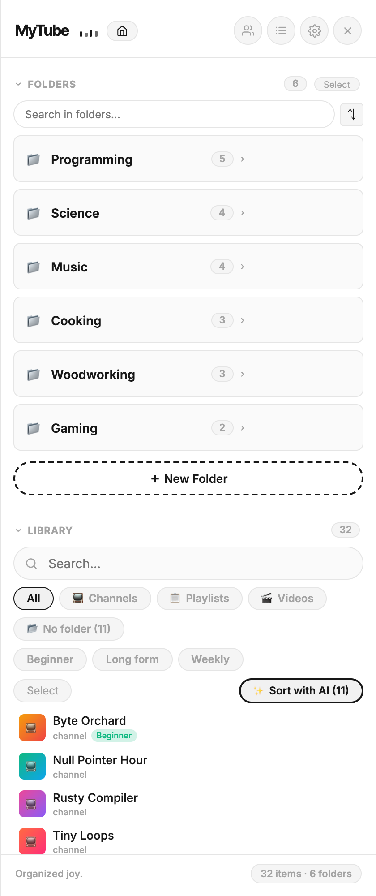
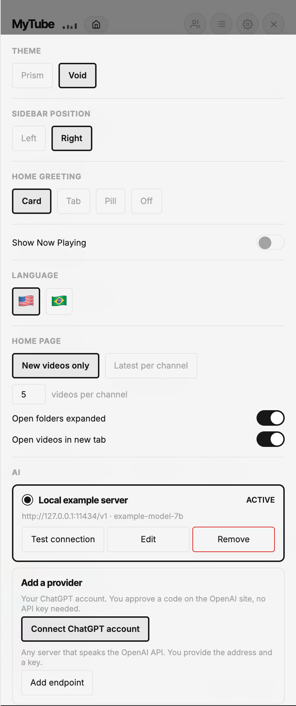
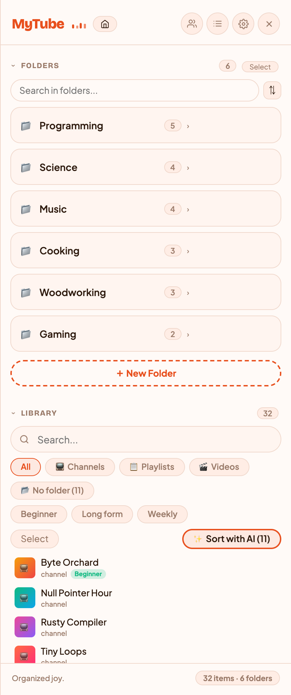
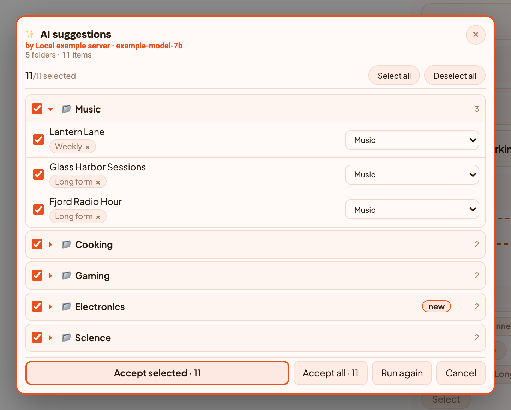

# MyTube

A Chrome extension that lets you sort your YouTube subscriptions, playlists and videos into folders and tags, right inside YouTube.

**English** · [Português](README.pt-BR.md)

[](https://github.com/pedroberaldo87/MyTube/actions/workflows/ci.yml)
[](LICENSE)


<p align="center">
  
  
  
</p>

All screenshots use made-up channels and folders.

## Features

- **Nested folders** for channels, playlists and videos, with drag and drop
- **Tags** that cut across folders
- **AI sorting** (optional): a model proposes a folder and tags for each unfiled item, and nothing is saved until you approve it. See [AI sorting](#ai-sorting-optional)
- **Home feed**: new videos from all your folders, collapsible by folder and channel, in two modes ("new only" or "latest N per channel")
- **Folder feed**: recent videos from one folder's channels on a single page, grouped by channel
- **New-video badges** on thumbnails and in the meta row, with a count per channel
- **New-video detection** by reading channel pages (relative dates are parsed in English and Brazilian Portuguese)
- **Mute / unmute channels**: channels start muted, so you only get badges for the ones you turn on
- **Mark as read** per channel, per folder (recursive), or all at once
- **Hover actions** on channels and library items: add to folder, tag, mute, delete, unsubscribe
- **Two themes**, Void (minimal dark) and Prism (warm and colorful), with six accent colors
- **Sidebar inside youtube.com**, on the left or the right, toggled with ⌘/Ctrl + .
- **Duplicate matching** by channel ID, URL, handle and name, because YouTube exposes channels in inconsistent shapes
- **Export / Import** as JSON, with merge or replace
- **English and Brazilian Portuguese** interface
- **Local data**: folders and tags live in `chrome.storage` and IndexedDB. No server, no account. Details under [Privacy](#privacy)

## Quick start

MyTube is not on the Chrome Web Store, so you build it and load it yourself. It takes about two minutes.

You need [Node.js](https://nodejs.org) 20 or newer (`node -v` to check), git and Chrome.

### 1. Build

```bash
git clone https://github.com/pedroberaldo87/MyTube.git
cd MyTube
npm ci
npm run build
```

This creates a `dist/` folder. **`dist/` is the extension**, not the repository root.

### 2. Load it into Chrome

1. Open a new tab and type **`chrome://extensions`** in the address bar (Chrome does not open it from a link).
2. Turn on **Developer mode**, the toggle in the top right corner.
3. Click **Load unpacked**.
4. Select the **`dist`** folder itself. Do not open it and pick a file inside.

MyTube now appears in the list with a version number. If Chrome shows an error instead, the build did not finish: run `npm run build` again and read its output.

### 3. Pin it to the toolbar

Chrome hides new extensions behind the puzzle-piece icon. Click it, find **MyTube** and click the pin. The toolbar icon is what opens the sidebar.

### 4. First run

1. Go to **youtube.com**. Reload the tab if it was already open, because content scripts only attach on page load.
2. Click the **MyTube** icon. The sidebar slides in. **⌘ + .** (macOS) or **Ctrl + .** toggles it too.
3. In the sidebar header, click the people icon (tooltip **Subs**) to go to your subscriptions page and import them, and the list icon (**Lists**) for your playlists.
4. Create a folder and drag channels into it, or let [AI sorting](#ai-sorting-optional) propose the structure.

### Updating

```bash
git pull
npm ci
npm run build
```

Then open `chrome://extensions` and click the reload icon on the MyTube card. Your folders and tags live in the browser's storage and survive the update.

### If something goes wrong

| Symptom | Cause |
|---|---|
| The icon does nothing on youtube.com | The tab was open before you installed. Reload it |
| Chrome refuses the folder | You selected the repository root instead of `dist/` |
| The card shows "Errors" | The build failed. Run `npm run build` and read the output |
| Everything vanished after an update | Chrome dropped the unpacked extension (it does this if `dist/` moved). Load it again; your data is in browser storage, not in `dist/` |

## Configuration

Everything is in the sidebar: click the gear icon.

| Setting | Options |
|---|---|
| Theme | Void, Prism |
| Accent color | Coral, Teal, Violet, Rose, Emerald, Gold |
| Sidebar position | Left, Right |
| Home greeting | Card, Tab, Pill, Off |
| Show Now Playing | On / Off |
| Language | English, Português (Brasil) |
| Home page | New videos only, or latest per channel (with a count) |
| Open folders expanded | On / Off |
| Open videos in new tab | On / Off |
| AI | Add and test providers, pick the active one |
| Data | Export / Import backup (merge or replace) |

There are no environment variables or config files.

## Usage

- **Organize**: create folders in the sidebar, drag channels and playlists into them, and add tags from the hover actions.
- **Follow new uploads**: unmute the channels you care about. MyTube checks channel pages every 30 minutes and shows badges. Mark them read per channel, per folder, or all.
- **Back up**: Settings → Data → **Export Backup** gives you a JSON file. **Import Backup** can merge it into what you have or replace it.

## AI sorting (optional)

Filing hundreds of subscriptions by hand is the boring part. Connect a model and it proposes a folder for each one. You stay the one who decides.

<p align="center">
  
</p>

**Connecting.** Open the sidebar, click the gear, then go to **AI**. Two options:

- **Your ChatGPT account**: approve a device code on openai.com. No API key involved.
- **Any OpenAI-compatible endpoint**: your own base URL and key. A local Ollama, LM Studio, vLLM, OpenRouter, or OpenAI itself. Chrome asks for permission to that host when you save it.

Then use **Test connection** to pick a model.

**Sorting.** In the Library, **✨ Sort with AI** works on what you selected, or, with nothing selected, on everything on screen that has no folder yet.

- **It suggests tags too.** Up to three per item, reusing your existing tags before inventing new ones. Remove one with a click on its chip.
- **Nothing is written until you accept.** Suggestions arrive grouped by destination folder, so 800 channels become a handful of decisions. Check or uncheck a whole group or one item, change any destination, then **Accept selected** or **Accept all**. New folders are created at that moment, not before.
- **The header names the model** that produced the suggestions, since swapping models changes the result.
- **Large libraries take a few minutes.** Items go out in batches of 20 and results stream in as each batch returns.

## Privacy

- Your organization data stays in `chrome.storage` and IndexedDB, in your browser. MyTube has no server and no analytics.
- If you connect an AI provider, **only the names of the items being classified and the names of your existing folders** are sent to it. No watch history, no video data, no identifiers. Nothing is sent until you connect a provider yourself.
- The UI fonts (Inter, or Bricolage Grotesque and Plus Jakarta Sans for Prism) are loaded from Google Fonts when the sidebar opens, like any web font.

### Permissions

Chrome shows a broad-sounding list. Here is what each entry is for and what is **not** granted at install:

| Permission | Why |
|---|---|
| `storage`, `unlimitedStorage` | Your folders, tags and watch history, in the browser. `unlimitedStorage` only lifts the 5 MB quota, which a large library exceeds |
| `tabs` | Telling the sidebar to open when you click the toolbar icon |
| `alarms` | Scheduling the check for new uploads |
| `https://www.youtube.com/*`, `https://youtube.com/*` | The sidebar itself: it is a content script injected into YouTube |
| `https://auth.openai.com/*`, `https://chatgpt.com/backend-api/*` | Only used if you connect a ChatGPT account: the device-code flow and the inference endpoint |

**About `optional_host_permissions` (`https://*/*`, `http://*/*`).** It grants nothing at install. It declares what MyTube is *allowed to ask for later*. Because you can point the AI at any endpoint (a local Ollama, a machine on your LAN, a hosted API), the manifest cannot know the address in advance. Chrome only lets an extension request hosts it declared, so declaring broadly is what makes it possible to request narrowly: one origin, when you save that endpoint, through Chrome's own dialog. Nothing is requested before that, and nothing else is ever requested.

## How it works

- **Content scripts** (`src/content/`) inject the sidebar and feed overlays into youtube.com, built with Preact inside Shadow DOM roots. A small MAIN-world script (`page-bridge.ts`) reads YouTube's own page data.
- **Service worker** (`src/background/`) owns storage access, polls channel pages for new uploads every 30 minutes via an alarm, and makes all AI calls. Credentials never leave it.
- **Storage**: folders, tags and library items in `chrome.storage.local`; watch history and new-video checks in IndexedDB (via `idb`).
- **Dashboard** (`src/dashboard/`) is the extension's options page.
- `build.ts` is the real build entry point (`vite.config.ts` only serves `npm run dev`). It bundles each part separately and writes `dist/manifest.json`.

Stack: Preact, TypeScript, Vite, Chrome Manifest V3, IndexedDB.

## Development

```bash
npm ci
npm run build       # type-check, then build into dist/
npm run typecheck   # types only
npm test            # test suite (node:test via tsx)
npm run package     # build, then zip dist/ into mytube.zip
npm run dev         # Vite dev server (dashboard page only, not the extension)
```

Six tests drive a real Chromium through Playwright, so install it once with `npx playwright install chromium`. There is no lint script.

## Security

Please report vulnerabilities privately. See [SECURITY.md](SECURITY.md).

## Contributing

Contributions are welcome. See [CONTRIBUTING.md](CONTRIBUTING.md) and the [Code of Conduct](CODE_OF_CONDUCT.md).

## License

[GNU General Public License v3.0](LICENSE).
