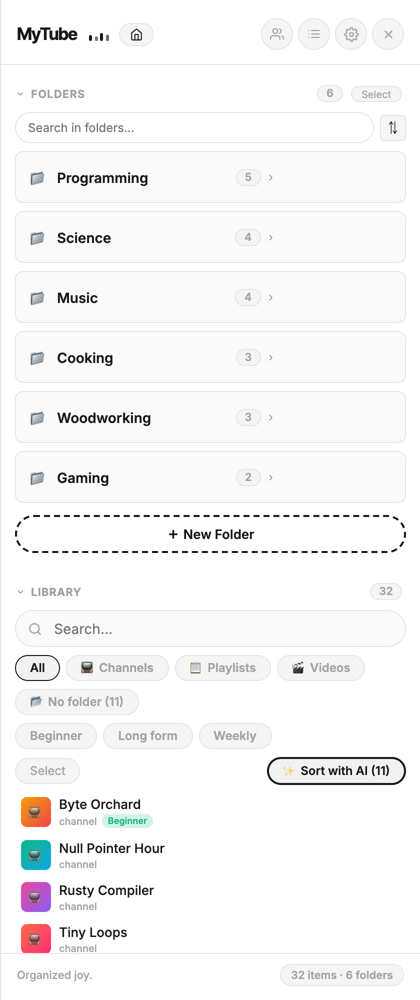
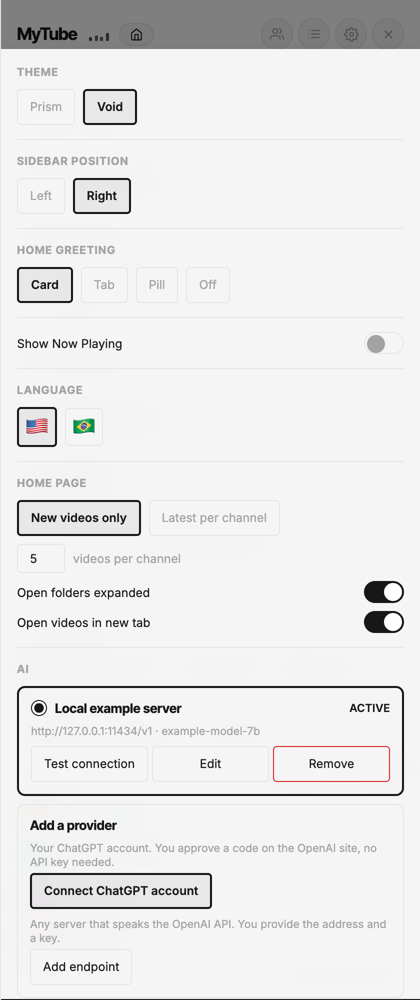
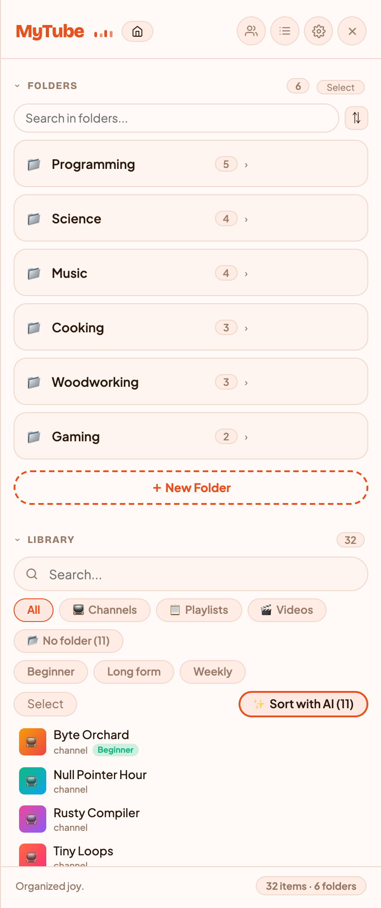
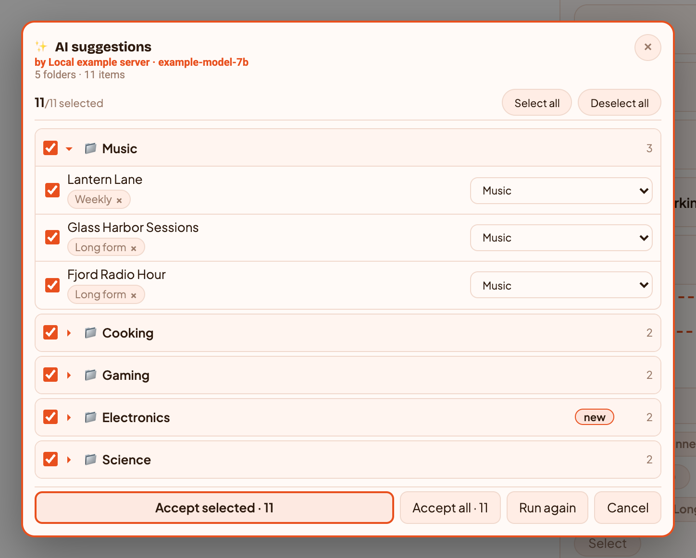

# MyTube

Uma extensão do Chrome para organizar suas inscrições, playlists e vídeos do YouTube em pastas e tags, direto dentro do YouTube.

[English](README.md) · **Português**

[](https://github.com/pedroberaldo87/MyTube/actions/workflows/ci.yml)
[](LICENSE)


<p align="center">
  
  
  
</p>

Todas as capturas de tela usam canais e pastas inventados. (A interface das imagens está em inglês.)

## Funcionalidades

- **Pastas aninhadas** para canais, playlists e vídeos, com arrastar e soltar
- **Tags** que atravessam as pastas
- **Organização por IA** (opcional): um modelo propõe pasta e tags para cada item sem pasta, e nada é salvo até você aprovar. Veja [Organização por IA](#organização-por-ia-opcional)
- **Home feed**: vídeos novos de todas as suas pastas, com seções recolhíveis por pasta e canal, em dois modos ("só novos" ou "últimos N por canal")
- **Feed de pasta**: vídeos recentes dos canais de uma pasta numa página só, agrupados por canal
- **Selos de vídeo novo** na miniatura e na linha de metadados, com contagem por canal
- **Detecção de vídeos novos** lendo as páginas dos canais (datas relativas são lidas em inglês e português do Brasil)
- **Silenciar / reativar canais**: os canais entram silenciados, então você só recebe selos dos que ativar
- **Marcar como lido** por canal, por pasta (recursivo) ou tudo de uma vez
- **Ações ao passar o mouse** em canais e itens da biblioteca: adicionar a pasta, tag, silenciar, excluir, cancelar inscrição
- **Dois temas**, Void (escuro e minimalista) e Prism (quente e colorido), com seis cores de destaque
- **Sidebar dentro do youtube.com**, à esquerda ou à direita, alternada com ⌘/Ctrl + .
- **Detecção de duplicatas** por ID, URL, handle e nome do canal, porque o YouTube entrega os canais em formatos inconsistentes
- **Exportar / Importar** em JSON, com mesclar ou substituir
- **Interface em inglês e português do Brasil**
- **Dados locais**: pastas e tags ficam em `chrome.storage` e IndexedDB. Sem servidor, sem conta. Detalhes em [Privacidade](#privacidade)

## Início rápido

O MyTube não está na Chrome Web Store, então você faz o build e carrega a extensão você mesmo. Leva uns dois minutos.

Você precisa de [Node.js](https://nodejs.org) 22 ou mais novo (`node -v` para conferir), git e Chrome.

### 1. Build

```bash
git clone https://github.com/pedroberaldo87/MyTube.git
cd MyTube
npm ci
npm run build
```

Isso cria a pasta `dist/`. **A `dist/` é a extensão**, não a raiz do repositório.

### 2. Carregar no Chrome

1. Abra uma aba nova e digite **`chrome://extensions`** na barra de endereço (o Chrome não abre essa página por link).
2. Ligue o **Modo do desenvolvedor**, o botão no canto superior direito.
3. Clique em **Carregar sem compactação**.
4. Selecione a própria pasta **`dist`**. Não entre nela para escolher um arquivo.

O MyTube passa a aparecer na lista, com um número de versão. Se o Chrome mostrar um erro, o build não terminou: rode `npm run build` de novo e leia a saída.

### 3. Fixar na barra de ferramentas

O Chrome esconde extensões novas atrás do ícone de quebra-cabeça. Clique nele, ache o **MyTube** e clique no alfinete. O ícone na barra é o que abre a sidebar.

### 4. Primeiro uso

1. Vá para o **youtube.com**. Recarregue a aba se ela já estava aberta, porque os content scripts só entram no carregamento da página.
2. Clique no ícone do **MyTube**. A sidebar entra deslizando. **⌘ + .** (macOS) ou **Ctrl + .** também alterna.
3. No cabeçalho da sidebar, clique no ícone de pessoas (dica **Canais**) para ir à página de inscrições e importá-las, e no ícone de lista (**Listas**) para as playlists.
4. Crie uma pasta e arraste canais para dentro, ou deixe a [organização por IA](#organização-por-ia-opcional) propor a estrutura.

### Atualizar

```bash
git pull
npm ci
npm run build
```

Depois abra `chrome://extensions` e clique no ícone de recarregar no card do MyTube. Suas pastas e tags ficam no armazenamento do navegador e sobrevivem à atualização.

### Se algo der errado

| Sintoma | Causa |
|---|---|
| O ícone não faz nada no youtube.com | A aba já estava aberta antes da instalação. Recarregue |
| O Chrome recusa a pasta | Você selecionou a raiz do repositório em vez da `dist/` |
| O card mostra "Erros" | O build falhou. Rode `npm run build` e leia a saída |
| Sumiu tudo depois de atualizar | O Chrome descartou a extensão sem compactação (acontece se a `dist/` mudou de lugar). Carregue de novo; seus dados estão no armazenamento do navegador, não na `dist/` |

## Configuração

Tudo fica na sidebar: clique na engrenagem.

| Opção | Valores |
|---|---|
| Tema | Void, Prism |
| Cor de destaque | Coral, Teal, Violet, Rose, Emerald, Gold |
| Posição da sidebar | Esquerda, Direita |
| Aviso na home | Card, Aba, Pílula, Desligado |
| Mostrar "Reproduzindo" | Ligado / Desligado |
| Idioma | English, Português (Brasil) |
| Página inicial | Só vídeos novos, ou últimos por canal (com quantidade) |
| Abrir pastas expandidas | Ligado / Desligado |
| Abrir vídeos em nova aba | Ligado / Desligado |
| IA | Adicionar e testar provedores, escolher o ativo |
| Dados | Exportar / Importar backup (mesclar ou substituir) |

Não há variáveis de ambiente nem arquivos de configuração.

## Uso

- **Organizar**: crie pastas na sidebar, arraste canais e playlists para dentro delas e adicione tags pelas ações que aparecem ao passar o mouse.
- **Acompanhar uploads novos**: reative os canais que importam. O MyTube checa as páginas dos canais a cada 30 minutos e mostra selos. Marque como lido por canal, por pasta ou tudo.
- **Backup**: Configurações → Dados → **Exportar Backup** gera um arquivo JSON. **Importar Backup** pode mesclá-lo ao que você já tem ou substituir tudo.

## Organização por IA (opcional)

Arquivar centenas de inscrições na mão é a parte chata. Conecte um modelo e ele propõe uma pasta para cada uma. Quem decide continua sendo você.

<p align="center">
  
</p>

**Conectar.** Abra a sidebar, clique na engrenagem e vá em **IA**. Dois caminhos:

- **Sua conta do ChatGPT**: você aprova um código no site da OpenAI. Sem chave de API.
- **Qualquer endpoint compatível com a API da OpenAI**: você informa a URL base e a chave. Pode ser um Ollama local, LM Studio, vLLM, OpenRouter ou a própria OpenAI. **Adicionar endpoint** abre uma janela separada do MyTube, então a chave é digitada ali e nunca na página do YouTube. O Chrome pede permissão para aquele host quando você salva. `http://` puro só é aceito para este computador e redes privadas (localhost, 192.168.x.x, 10.x.x.x, Tailscale); qualquer outro servidor precisa de `https://`. Trocar o endereço de um endpoint salvo apaga a chave e o modelo guardados, então digite a chave de novo.

Depois use **Testar conexão** para escolher o modelo.

**Organizar.** Na Biblioteca, **✨ Organizar com IA** age sobre o que você selecionou ou, sem seleção, sobre tudo que está na tela e ainda não tem pasta.

- **Ela sugere tags também.** Até três por item, reaproveitando suas tags antes de inventar nomes novos. Para tirar uma, clique no chip dela.
- **Nada é gravado até você aceitar.** As sugestões chegam agrupadas por pasta de destino, então 800 canais viram um punhado de decisões. Marque ou desmarque um grupo inteiro ou um item só, troque qualquer destino e então use **Aceitar marcados** ou **Aceitar tudo**. Pastas novas são criadas nesse momento, não antes.
- **O cabeçalho mostra o modelo** que gerou as sugestões, já que trocar de modelo muda o resultado.
- **Bibliotecas grandes levam alguns minutos.** Os itens saem em lotes de 20 e os resultados aparecem conforme cada lote volta.

## Privacidade

- Seus dados de organização ficam em `chrome.storage` e IndexedDB, no seu navegador. O MyTube não tem servidor nem analytics.
- Se você conectar um provedor de IA, **só os nomes dos itens que estão sendo classificados e os nomes das suas pastas** são enviados a ele. Nada de histórico, dados de vídeo ou identificadores. Nada é enviado até você mesmo conectar um provedor.
- As fontes da interface (Inter, ou Bricolage Grotesque e Plus Jakarta Sans no Prism) são carregadas do Google Fonts quando a sidebar abre, como qualquer fonte web.

### Permissões

O Chrome mostra uma lista de aparência ampla. Para que serve cada item e o que **não** é concedido na instalação:

| Permissão | Para quê |
|---|---|
| `storage`, `unlimitedStorage` | Suas pastas, tags e histórico, no navegador. O `unlimitedStorage` só tira o teto de 5 MB, que uma biblioteca grande ultrapassa |
| `alarms` | Agendar a checagem de uploads novos |
| `https://www.youtube.com/*`, `https://youtube.com/*` | A própria sidebar: ela é um content script injetado no YouTube |
| `https://auth.openai.com/*`, `https://chatgpt.com/backend-api/*` | Só usados se você conectar uma conta do ChatGPT: o fluxo de código de dispositivo e o endpoint de inferência |

**Sobre `optional_host_permissions` (`https://*/*`, `http://*/*`).** Não concede nada na instalação. Declara o que o MyTube *pode pedir depois*. Como você pode apontar a IA para qualquer endpoint (um Ollama local, uma máquina da sua rede, uma API hospedada), o manifest não tem como saber o endereço de antemão. O Chrome só deixa a extensão pedir hosts que ela declarou, então declarar amplo é o que permite pedir estreito: uma origem, quando você salva aquele endpoint, pelo diálogo do próprio Chrome. Nada é pedido antes disso, e nada além disso é pedido.

## Como funciona

- **Content scripts** (`src/content/`) injetam a sidebar e as camadas de feed no youtube.com, feitas com Preact dentro de raízes Shadow DOM. Um script pequeno no MAIN world (`page-bridge.ts`) lê os dados da própria página do YouTube.
- **Service worker** (`src/background/`) cuida do acesso ao armazenamento, consulta as páginas dos canais a cada 30 minutos por um alarme e faz todas as chamadas de IA. As credenciais não saem dele.
- **Janela de chave de API** (`src/aikey/`) é uma página da extensão, aberta como uma janelinha. É o único lugar onde uma chave de API é digitada.
- **Armazenamento**: pastas, tags e itens da biblioteca em `chrome.storage.local`; histórico de visualização, checagens de vídeos novos e os provedores de IA (com chaves de API e tokens do ChatGPT) no IndexedDB da extensão (via `idb`). Scripts do youtube.com leem o `chrome.storage.local`, mas não abrem o IndexedDB da extensão; por isso as credenciais ficam lá.
- **Dashboard** (`src/dashboard/`) é a página de opções da extensão.
- O `build.ts` é o ponto de entrada real do build (o `vite.config.ts` só serve o `npm run dev`). Ele empacota cada parte separadamente e escreve o `dist/manifest.json`.

Stack: Preact, TypeScript, Vite, Chrome Manifest V3, IndexedDB.

## Desenvolvimento

```bash
npm ci
npm run build       # checa os tipos e gera o build em dist/
npm run typecheck   # só os tipos
npm test            # suíte de testes (node:test via tsx)
npm run package     # build e zip da dist/ em mytube.zip
npm run dev         # servidor Vite (só a página do dashboard, não a extensão)
```

Seis testes dirigem um Chromium de verdade pelo Playwright, então instale-o uma vez com `npx playwright install chromium`. Não há script de lint.

## Segurança

Reporte vulnerabilidades em privado. Veja o [SECURITY.md](SECURITY.md) (em inglês).

## Contribuir

Contribuições são bem-vindas. Veja o [CONTRIBUTING.md](CONTRIBUTING.md) e o [Código de Conduta](CODE_OF_CONDUCT.md) (em inglês).

## Licença

[GNU General Public License v3.0](LICENSE).
